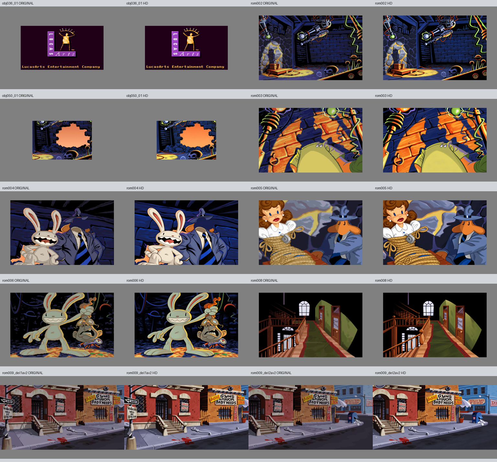

# Bestilling 2, 13. oktober 2026

Ti HD-bilder er levert i godkjent stilretning: obj036_01, rom002, obj050_01, rom003, rom004, rom005, rom006, rom008 og begge deler av rom009. Tom har autorisert fortsettelsen av hele HD-konverteringen. Disse ti nye bildene er visuelt egenkontrollert, men er ikke individuelt godkjent av Tom eller prøvd i spillmotoren.

## Resultat og kildegrunnlag

LucasArts-logoens historiske figur, lilla L og tekst er bevart. Laboratoriet er tegnet uten nye personer; obj050 viser hullet i veggen og sammenraste murstein, ikke en eksplosjon. I introens nærbilder er de tilsiktede ufullstendige ansiktsflatene bevart for separate animasjonslag. Sams øvre lukkede øyne i rom005 finnes allerede i kilden. Max holder forskerens mekaniske hode i rom006, med kildens grønnlige scenelys.

Gangen beholder romtopologi, dører og lesbar Flint Paper-tekst. Den lille bakre dørteksten er ikke sikkert lesbar. Et første forsøk la til dekorative løkker. Disse er rettet til enkle mørke tegnklaser uten ordgjetting. Bare det lille tegnområdet ble komposittert; resten er byte-uendret. Se [før og etter](rom008-doortekst-qa.png).

Gatens dokumenterte skilttekst er bevart, inkludert SOILED OFFICE SPACE AVAILABLE og REALLY BAD FOOD. Avkuttet høyreskilt, blodflekk, søppel, bøyd parkometer og fem spisse gitterstenger er kontrollert. Begge utsnitt kommer fra samme [fullscene](rom009-fullscene.png). Ingen geometriwarp er brukt.

Detaljert kildeanalyse, usikkerhet og etterbehandling finnes i [gruppe A](a-kilde-qa.md), [gruppe B](b-kilde-qa.md), [gruppe C](c-kilde-qa.md) og hvert jobbnotat. Små slitasjemerker er nytegnet og har ikke bevist identisk detaljtelling. Uleselig tekst er behandlet som form, uten påstått transkripsjon.

## Kontroller

- Alle ti leveranser gir OK med prosjektets uendrede sjekk_leveranse.py.
- Alle har 1536 x 1024, korrekt motivrektangel og eksakt RGB128-padding.
- Alle 40 beskyttede kildefiler matcher de låste SHA-256-verdiene.
- Gateutsnittenes felles område på 1152 x 800 er byte-identisk.
- Resultat-SHA er kontrollert mot agentmanifestene og samlet i [fremdrift.json](fremdrift.json). Maskinlesbare kontrollresultater står i [sluttkontroll.json](sluttkontroll.json).

Produksjonsagentene bruker gpt-6-astra etter Toms ønske. Bildene er laget med den innebygde ChatGPT-bildegeneratoren; eksakt bildemodellnavn eksponeres ikke. Originalprompter, nødvendige kildepresiseringer, råforsøk og bildebehandlingsoppskrifter er bevart i denne mappen. Autorisasjonen til presis skalering og plassering er videreført fra samme oppdrag. Ingen beskyttede jobbfiler, motor, pipeline, status.csv eller ORDRE.md er endret.

## Gjenstår

Motorimport, maskesamspill, samlet animasjonsvisning og faktisk spilltest utføres i motorarbeidet. Teknisk OK og visuell egenkontroll er separate fra Toms endelige visuelle godkjenning. Bestilling 3 er startet som neste gruppe i den allerede autoriserte HD-konverteringen.
