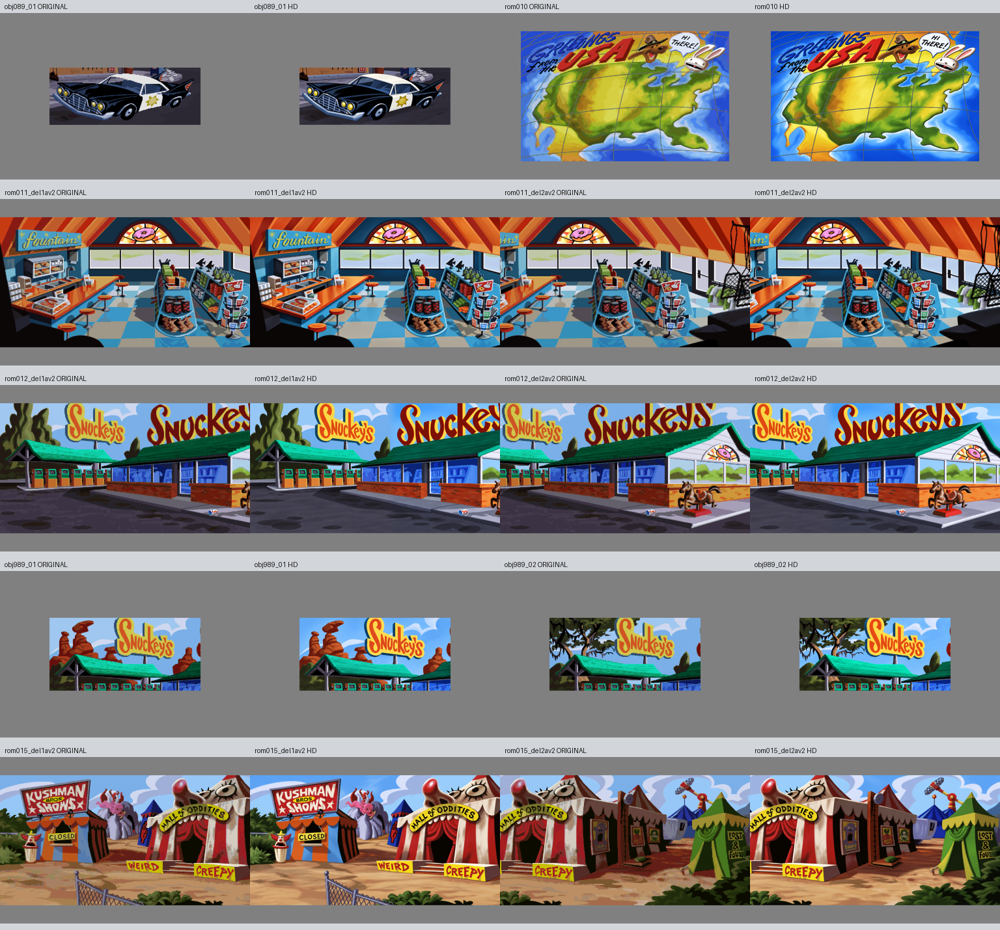

# Bestilling 3, 13. oktober 2026

Ti nye HD-bilder er levert i godkjent stilretning: obj089_01, rom010, rom011 og rom012 i to deler hver, obj989_01, obj989_02 og rom015 i to deler. Alle består uendret egenkontroll. Tom har autorisert videre produksjon; disse nye bildene har ikke individuell brukergodkjenning eller spilltest.

## Kildetro innhold

Bilen er parkert utenfor kontoret med fire frontlykter, to synlige hjul, stjerne på døren og bakfinner. Dens kildeplassering ble rettet samlet fire HD-piksler, uten originalpikselmaskering. USA-kartet har kildens skjeve geografi, rutenett, Sam og Max og teksten GREETINGS from the USA og HI THERE! Kartoriginalen inneholder ingen reisemålsikoner; disse tegnes separat av spillet og er ikke lagt til bakgrunnen.

Snuckey's har bevart fountain-skilt, fem krakker, varehyller, de to utvendige Snuckey's-skiltene, sju bensinpumper og hesten. Objekt989 sine to tilstander viser ulike bakgrunner: røde ørkenformasjoner og mørke trær med hengende vegetasjon. De er behandlet som kildebaserte scenetilstander, uten å gjette et mer spesifikt stedsnavn.

Karnevalet har bevart KUSHMAN BROS SHOWS, CLOSED, HALL of ODDITIES, WEIRD og CREEPY. Første D i ODDITIES var feiltegnet som P i første forsøk. Et lokalt innebygd bilde-edit rettet bokstaven før levering. Bare det nye bokstavutsnittet ble satt inn i fullscenen. Små plakatglyfer og vareetiketter er ikke erklært detaljidentiske. Delvis synlig LOST & FOU... er ikke utvidet utenfor kildens synlige område.

Kildeanalyse og begrensninger: [A](a-kilde-qa.md), [B](b-kilde-qa.md), [C](c-kilde-qa.md). Råforsøk, faktiske prompter og oppskrifter er bevart. Alle ti jobber har norske notater.

## Kontroller

- Ti leveranser gir OK med prosjektets uendrede sjekk_leveranse.py.
- 1536 x 1024, eksakt RGB128-padding og resultat-SHA er kontrollert.
- Alle 40 beskyttede kildefiler matcher låste SHA-256-verdier.
- Overlapp er byte-identisk fra felles master: rom011 og rom012 har 1152 x 800, rom015 har 544 x 800.
- [Fremdrift](fremdrift.json) og [sluttkontroll](sluttkontroll.json) skiller levert, stilgodkjent, individuelt godkjent, importert og runtime.

Produksjonsagentene bruker gpt-6-astra. Bildene er laget med innebygd ChatGPT-bildegenerator; eksakt bildemodellnavn eksponeres ikke. Presis bildebehandling følger Toms videreførte autorisasjon i samme oppdrag. Ingen motor-/pipelinekode, beskyttede jobbfiler, ORDRE.md eller status.csv er endret.

Forrige bestilling er pushet som 829caa876e8b0459cce16cd2cbff44972b05f4cc. Alle ti PNG-filer er hentet tilbake fra GitHub ved denne commiten og matcher lokale SHA-verdier; se [pushkontroll](bestilling002-pushkontroll.json).

Motorimport, objektmasker, samlet animasjon og spilltest gjenstår i motorarbeidet. Bestilling 4 er startet under den samme autorisasjonen til resten av HD-konverteringen.
