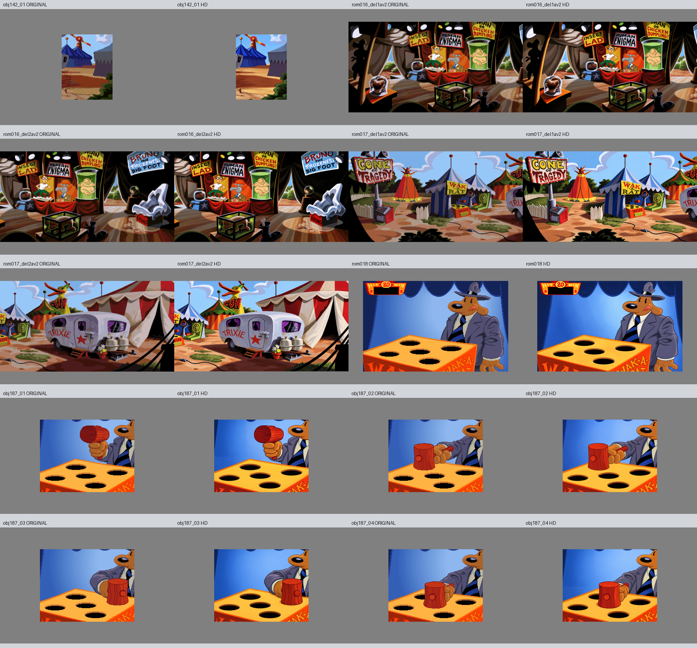

# Bestilling 4, 13. oktober 2026

Ti nye HD-bilder er levert: obj142_01, rom016 og rom017 i to deler hver, rom018 og obj187_01 til obj187_04. Alle gir OK med uendret egenkontroll. Bildene følger Toms godkjente stil og autorisasjon til videre HD-konvertering; individuell ny bildegodkjenning og motorprøving er ikke utført.

## Identitet og tilstander

Obj142 er passasjeutsnittet ved karnevalet uten personer eller lesbar tekst. Hall of Oddities beholder utstillingene: Insect Lad, Human Enigma med vannkran til hode, den bleke figuren i grønn tank, de små montrene og Brunos tomme, brukkede isform. Det brune vesenet i forgrunnsmonteren er sammenlignet visuelt fra originalen; navn og art er ikke bevist. Skiltteksten er kontrollert, inkludert BRUNO THE FROZENEST BIG FOOT. Kildens avkuttede bokstaver er fortsatt avkuttet.

Midway beholder CONE OF TRAGEDY, WAK A RAT, WIN, TRIXIE og GUN, hengeren, gjerdene og kabelen. Rom018 viser Sams originale pose og tungeuttrykk, fem tomme hull og et tomt svart tellefelt. Spillet legger til aktive rotter og poeng separat.

De fire obj187-bildene viser samme røde treklubbe i fire stillinger. Grep, hånd, frakk, skaft og klubbens orientering er kontrollert samlet. Fem hull finnes på brettet; hull som er skjult av klubben i kilden er fortsatt skjult.

## Kontrollavvik og retting

Første obj187_01-forsøk hadde reelle plasseringsavvik og ble erstattet. I det neste forsøket var motivgeometrien nær originalen, men FFT-kontrollen fant store blokkskift i en tom blå bakgrunnsblokk. Samme avvik oppstod i tilstand04. Diagnosen viste at kildens bakgrunnsområde på 73 x 84 originalpiksler er byte-identisk i 01, 03 og 04. Det tilsvarende nytegnede området fra tilstand03 er derfor gjenbrukt i 01 og 04 med smal fjæring. Dette harmoniserer en faktisk felles bakgrunn. Ingen figur ble flyttet eller warpet, ingen originalpikselmaske eller endret kontrollterskel ble brukt. Førversjoner og oppskrift er bevart.

Etter rettingen består alle ti egenkontrollen. Root har kontrollert 1536 x 1024, eksakt RGB128-padding, manifest-SHA og alle 40 beskyttede kildehashene. Rom016 har byte-identisk overlapp 1152 x 800 og rom017 har 544 x 800 fra sine felles fullscener. Se [fremdrift](fremdrift.json) og [sluttkontroll](sluttkontroll.json).

Kildeanalyse og detaljer: [A](a-kilde-qa.md), [B](b-kilde-qa.md), [C](c-kilde-qa.md). Råforsøk, komplette prompter, lokale rettinger, produksjonsoppskrifter og norske jobbnotater er bevart. Mikrodetaljer og små ornamenter er ikke bevist detaljidentiske. Faktisk spillanimasjon og maskesamspill er uverifisert.

Produksjonsagentene bruker gpt-6-astra og innebygd ChatGPT-bildegenerator. Eksakt bildemodellnavn er ikke eksponert. Ingen motor-/pipelinekode, beskyttede kilder, ORDRE.md eller status.csv er endret. Forrige bestillings ti PNG-filer er hentet fra GitHub ved commit 7b230e07939a502394f704d9b161b7bf799e09ed og SHA-verifisert; se [pushkontroll](bestilling003-pushkontroll.json).

Bestilling 5 er startet. Motorimport, spilltest og individuell visuell sluttgodkjenning er egne gjenstående trinn.
