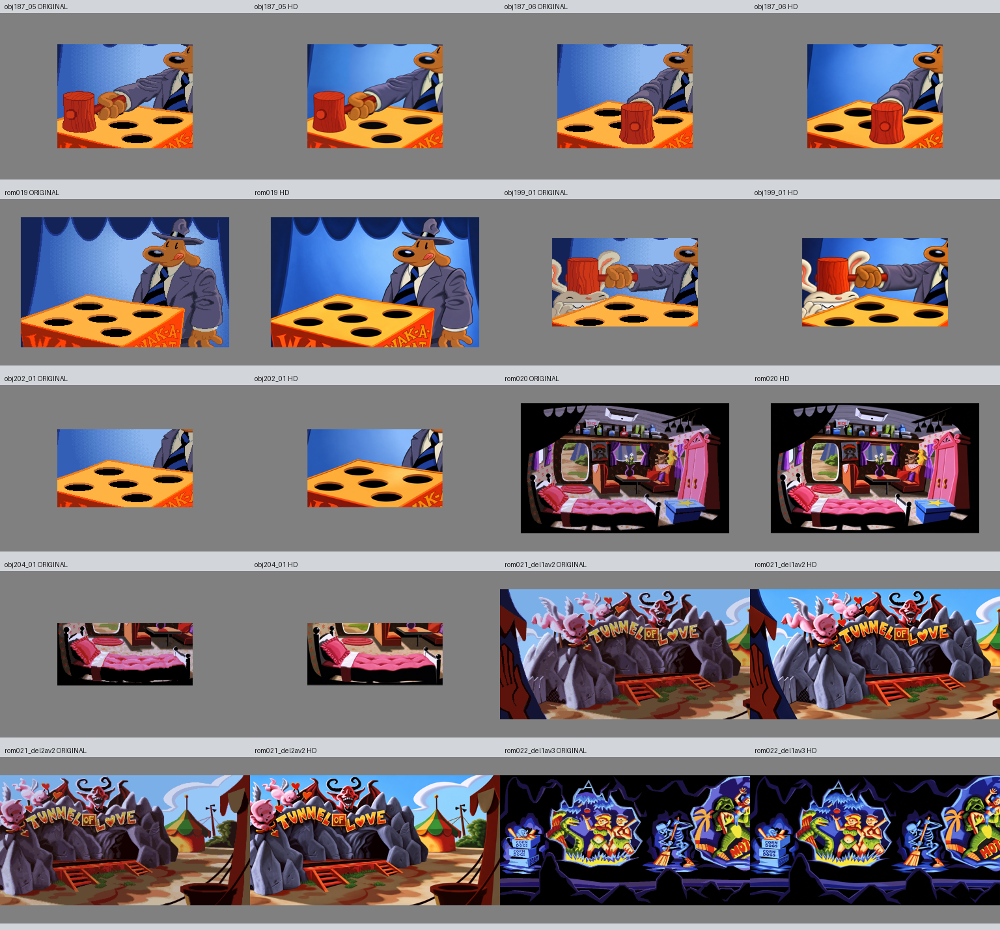

# Bestilling 5, 13. oktober 2026

Åtte bilder har egenkontroll OK, ett er levert med SJEKK og ett er fortsatt en arbeidskandidat med FEIL. Dette er ikke en ferdig godkjenning av hele bestillingen. Produksjonen fortsetter med uavhengige jobber under Toms autorisasjon.

| Status | Jobber |
| --- | --- |
| OK | obj187_06, rom019, obj199_01, rom020, obj204_01, rom021_del1av2, rom021_del2av2, rom022_del1av3 |
| SJEKK, mottakskontroll nødvendig | obj202_01: skift 0.93, blokk 1.11, kantlikhet 0.91 |
| FEIL, ikke klar for mottak | obj187_05: skift 0.15, blokk 7.92, kantlikhet 0.97 |

Minispillbildene beholder Sams klubbegrep, Max sin kildepose og tomme brettfelt. Rom019 har ingen poengtavle i originalen; den er ikke lagt til. Trixies vogn og sengeobjektet er separate kildetilstander. RICE, vase/blomster, stjerne på esken, møbler og den tomme sengen er bevart. Små plakatidentiteter og mikrodetaljer er visuelt tolket, ikke kildebekreftet ved navn.

Tunnel of Love-inngangen beholder to cupider, djevelen og kildens bokstav-/hjerteformer. Rom021-overlappen på 1152 x 800 er byte-identisk. Rom022 kommer fra én fullmaster laget fra alle tre originaldeler. Global plassering og en kildebasert nytegning av høyre del rettet reelle avvik. Del1 er byte-uendret av den lokale høyretegningen; del2/3 leveres i bestilling6 fra samme master. Registeret låser SHA og klippebokser.

Root og en uavhengig Astra-agent har undersøkt blokkavvikene i obj187_05/obj202_01. Store FFT-utslag er lokalisert til den blå bakgrunnen; figur/brettgeometrien viser ikke en tilsvarende stor flytting. Identiske kildebakgrunner er dokumentert. Dette støtter en hypotese om ustabil korrelasjon i gradient/dithering, men beviser ikke en algoritmefeil. Ingen kontrollterskel eller pipelinekode er endret. Se [kontrollavvik](KONTROLL-AVVIK.md), [rootdiagnose](root-blokkdiagnose.json), [gruppe C](c-kilde-qa.md) og jobbnotatene.

Alle ti lagrede resultater har 1536 x 1024, eksakt RGB128-padding og verifisert SHA. De 40 beskyttede kildefilene er uendret. [Fremdrift](fremdrift.json) markerer FEIL-kandidaten med klar_for_mottak=false. Den er bevart for sporbarhet og forblir ukrysset i grafikkliste. [Sluttkontroll](sluttkontroll.json) fører de faktiske statusene, uten å oppgradere SJEKK eller FEIL til OK.

Råforsøk, prompter, presis bildebehandling og avviste kandidater er bevart. Produksjonsagentene bruker gpt-6-astra; innebygd bildeverktøy eksponerer ikke eksakt bildemodellnavn. Ingen beskyttede filer, ORDRE.md, status.csv eller produktkode er endret. Forrige bestillings ti PNG-filer er SHA-verifisert fra GitHub ved b2d49e751eb4f18d72a56c01e93a99e0f0df3b45, se [pushkontroll](bestilling004-pushkontroll.json).

Motorimport, maskesamspill, faktisk spillanimasjon og individuell ny visuell godkjenning er uverifisert. Bestilling6 og7 fortsetter uavhengig av det ene uavklarte kontrollproblemet.
