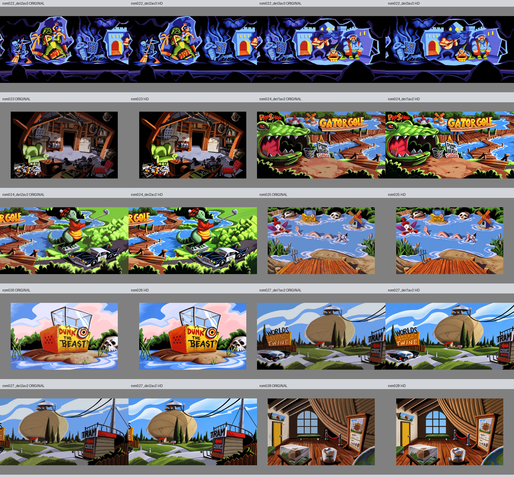

# Bestilling 6, 13. oktober 2026

Ti rombilder er levert med uendret egenkontroll OK: rom022 del2/3, rom023, rom024 del1/2, rom025, rom026, rom027 del1/2 og rom028. Root har sammenlignet original og HD samlet. Ny individuell brukergodkjenning, motorimport og spilltest er ikke utført.

Rom022 avslutter den felles Tunnel of Love-masteren fra bestilling5. Den høyre delen ble nytegnet fra originalen for å rette faktisk geometri. Del1 og begge overlappene er uendret. Alle tre delene er kontrollert sammen, også over bestillingsgrensen, med to byte-identiske overlapp på720 x800.

Dougs gjemmested er tomt, med opprinnelig maskineri, møbler og rot. Gator Golf beholder alligatorhodet som bygning og den golfende alligatorstatuen, bilen, gangbroene, vannet og PRO SHOP/GATOR GOLF/DUNK THE BEAST/CLOSED. Statuen er behandlet som statue, ikke en ny levende figur.

Rom025 viser golfbakgrunnen med de originale målfigurene. SWING/QUIT-knappene fra det generiske romnotatet finnes ikke i denne kildebakgrunnen og er derfor ikke lagt til. Rom026 viser en tom dunk-tank med DUNK THE BEAST; ingen figur er satt inn. Rom027 beholder hyssingballen, toppbygningen, bilen, kablene og kildeordene WORLDS/LARGEST/BALL OF/TWINE og TRAM/MUSEUM. Museet beholder store hyssingtråder, vindu, benker, montrene og avsperringen. Uleselig tavletekst er behandlet som form uten ordgjetting.

Alle ti PNG-filer har1536 x1024, eksakt RGB128-padding og verifisert SHA. Alle40 beskyttede kildefiler er uendret. Rom024-overlapp512 x800 og rom027-overlapp1184 x800 er byte-identiske fra felles fullscener. Se [fremdrift](fremdrift.json), [sluttkontroll](sluttkontroll.json) og kildeanalysene [A](a-kilde-qa.md), [B](b-kilde-qa.md), [C](c-kilde-qa.md).

Råforsøk, faktiske prompter, mastere, rettinger og bildebehandlingsoppskrifter er bevart. Små ornamenter og mikrodetaljer er ikke bevist identiske; teknisk OK er ikke semantisk eller visuell sluttgodkjenning. Produksjonsagentene bruker gpt-6-astra og innebygd bildeverktøy. Eksakt bildemodellnavn er ikke eksponert.

Ingen beskyttede kilder, motor-/pipelinekode, ORDRE.md eller status.csv er endret. Den uavklarte obj187_05-kandidaten fra bestilling5 forblir FEIL og ukrysset; obj202_01 er levert med SJEKK. Dette endrer ikke de ti faktiske OK-resultatene her. Bestilling7 fortsetter innenfor Toms autorisasjon.
