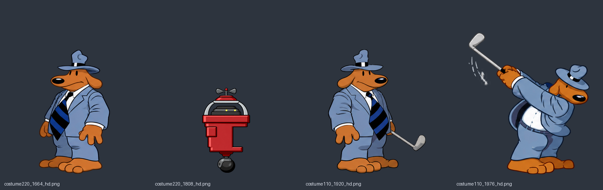

# Felles Linux-/Windows-pakke med 1654 native ruter, 19. oktober kveld

Begge nye pakker er bygget og kontrollert fra main 01ee58f75bffd77870f5c197deeaf5842d8efd06 og hd-mod bd65ce87f0f690ac19aa1c316f376a2e23810193. 1654 native figurruter er med, 108 flere enn forrige fellespakke fra i dag: 44 Sam-/robotruter og 64 Sam-golfruter. Grafikkarbeidet er fortsatt under arbeid. [Felles kveldspakke er publisert og bekreftet Latest](https://github.com/Tombonator3000/Sam-Max-HD/releases/tag/sam-max-hd-2026-10-19-kveld). Release-ID 417611325; alle fire opplastinger kontrollert både før og etter publisering. Se publisert.json.

Linux-bygg 39300993297 og Windows-bygg 39301000180 er begge completed/success og har samme fulle kode-SHA. Linux består oppstart og Debian 12 uten byggepakker. Windows består automatisert oppstart med HD og MT-32. Det er ingen endringer i engine, pipeline, tools eller .github siden forrige fellespakkes 73b63a9b; dette er en datapakkeoppdatering. Alle byggesteg og faktiske BYGG.txt er bevart i kontrollfilene.

## Nedlastinger og innhold

| Fil | SHA-256 | Byte |
| --- | --- | ---: |
| SamMaxHD-x86_64.AppImage | 80fa043bda339549385b633cdb20549292572284d32021e77724849e30bfe195 | 397105656 |
| SamMaxHD-Windows.zip | 5325a17a6ca0496e7917aee61a05a58a40873a2a23e6ad4395156624215336df | 505799382 |

Begge faktiske nedlastinger og hver sin SHA-fil er kontrollert med sha256sum -c. Alle fire nedlastede filer stemmer med GitHubs størrelse og SHA-256-digest. Alle 19 895 runtime moddfiler i hver pakke er byteidentiske med publisert modd og med hverandre. Bare README.md utelates av pakkeskriptene, som før. Alle 108 nye native-hasher stemmer med leveransekvitteringene. Ikke brukt bestillingstidspunkt eller filnavn som bevis for riktig innhold.

## Faktisk Linux-motor

Den uendrede nedlastede motoren har SHA-256 76c736a695b54d802c4ff22c2c9d6426275f406d5771faac90a2555f64aa171b. Pakkens egne spillfiler og modd brukes, med isolerte HOME/XDG, egen ini og kopierte saves per prøve, dummy skjerm/lyd, gfx normal, builtin GUI og null musikk. Ingen lokal retningskrok eller erstatning av binæren med en utviklerversjon.

Tolv prøver: inventar, akvarium og cafeteriarør; kostyme220 animasjon1/7/8/9/10 i rom43 og kostyme110 animasjon1/7/8/9 i rom25. Alle 108 nye native er registrert tegnet, ingen mangler. 654 skjermbufferkontroller, 573 fra figurstart uten avvik. De fem kjente 160-avvikene ved frame36 før testfiguren i rom43 er identiske med tidligere grunnlag. Alle øvrige målinger er null. Disse er ikke erklært som løste naturlige rombyttefeil.

Alle tolv valgte hele motorbilder er visuelt sett i to oversikter og lagret separat med kildehash. Uendrede native PNG-er fra den faktiske nedlastingen er samlet i forhandsvisning.png; ingen reskalering eller nytegning. Den røde vedlikeholdsroboten, Sams åpningstilstander, golfputteren, grep, hode og overgangene er sett. Øvrige aktørers naturlige skripthendelser inngår ikke i tvungne kostymetester; det forklarer blant annet at test-Sam kan forsvinne i animasjonene som bare viser roboten.

Ikke full naturlig gjennomspilling, interaktiv Windows-spilling eller ny nettleserprøve. Tidligere motiv-/bakgrunns-/kantfeil, omrissmerknader og uobservert costume204_286 står fortsatt åpne. Dagens nye grafikk er egenkontrollert av Codex, ikke ny Tom-godkjenning eller separat Claude-kontroll. Tekniske nullavvik alene beviser ikke at alle historiske grafikkfeil er løst.

## Kilder og videre arbeid

Grafikken og faktiske bildekall finnes i ../sam-automat-20261019 og ../sam-golf-20261019. Der står råbilder, originale motiv, stilankere, prompter, alfa-/størrelseskontroll, SHA-festede rutekart, native mottak og publiseringskvitteringer. Bibliotekets publisert-mod-er-fasit brukes til å beholde tidligere filer og kontrollere den publiserte modden mot de faktiske pakkene.

164 av 1758 figurjobber har resultat, 1594 mangler pluss returer. Fig110_05/06 har 28 åpne ruter etter avslag E, fig246_16 til 19 har tolv åpne VR-ruter etter et separat avslag. Ingen gjentakelse eller omgåelse av avviste grunnlag. Neste uavhengige bunke fig152_01 til 06 er klargjort med 82 spillruter, 46 ulike kilder og 24 beskyttede SHA-er. Alle seks originale ark, godkjent Sam-hovedark og fire originale motorforløp er sett. Grønn pantograf, håndtilbehør, fiskemagnet og humørring er kildeavklart. Ingen nytegning eller bildekall for 152 fra denne klargjøringen. Automatisk fortsettelse består; gammel nattkontroll og tre opprinnelige stasher er bevart.

## Publisering bekreftet

Draften ble kontrollert før publisering, deretter offentliggjort 19. oktober 18:30:42 UTC (20:30 norsk tid) og bekreftet Latest. Alle fire filer har riktig størrelse og SHA-256-digest i publisert GitHub-metadata. Tidligere felles- og plattformreleaser er beholdt. Dette kontrollpunktet er fullført; neste arbeid er faktisk nytegning av den allerede klargjorte 152-bunken.
