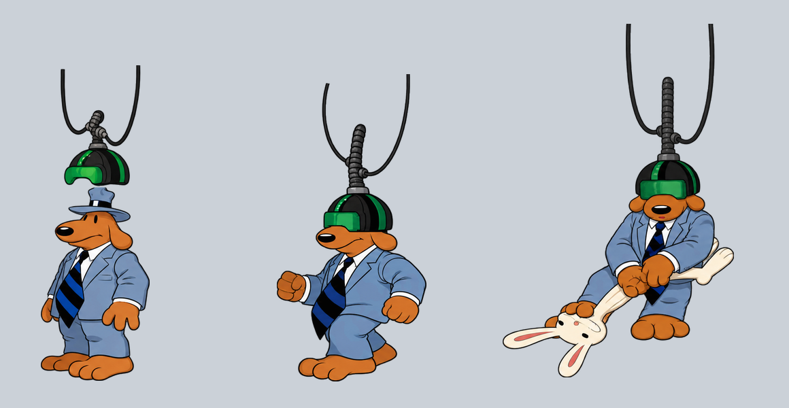

# Felles Linux-/Windows-pakke med 1546 native ruter, 19. oktober 2026

Begge nedlastede pakker har main 73b63a9b2b7af18fc045ac2431db7b7b1f2f8339 og hd-mod d31c30f269ed7b0b8746b5b1dfb5c50551cc900d. Det er 1546 native figurruter, 160 flere enn fellespakken fra 18. oktober. Sam i strikk, Max på kjøkkenet, hatte-/hånddelene og 82 VR-ruter er med. Grafikken er fortsatt under arbeid. Dette er ikke en ferdig HD-utgave av alle figurene.

[Linux-bygg 39286953973](https://github.com/Tombonator3000/Sam-Max-HD/actions/runs/39286953973) og [Windows-bygg 39286957890](https://github.com/Tombonator3000/Sam-Max-HD/actions/runs/39286957890) er begge completed/success og har samme fulle kilde-SHA. Linux består oppstart og Debian 12, Windows består automatisert oppstart med HD og MT-32. Pakkenes faktiske BYGG.txt og moddfiler er lest. Tidspunktet da et bygg ble bestilt brukes ikke som bevis for hvilken modd det inneholder.

## Faktiske nedlastinger

| Fil | SHA-256 | Byte |
| --- | --- | ---: |
| SamMaxHD-x86_64.AppImage | f2ff67f6b016dd7f34aef3cb2c9ac9cfe612effb6d57ddb9e3f7762dfc8792ea | 394029560 |
| SamMaxHD-Windows.zip | f89b04065969c2c723368eb643c46ce9d97c689cd12aea3a23a5538fde51b685 | 498354525 |

Begge sidefiler er kontrollert med sha256sum -c. Nedlastet størrelse og hash stemmer også med GitHubs asset-metadata. Alle 19 787 runtime moddfiler i hver pakke er byteidentiske med publisert modd og hverandre. Bare README.md utelates av pakkeskriptene som før. Native filer, indeksbilder, rom, objekter, metadata og øvrige runtime-filer er med i den fulle filmanifestkontrollen. Se nedlastinger-kontroll.json og moddfiler-kontroll.json.

Det er ingen endringer i engine, pipeline, tools eller .github mellom forrige fellespakkes ed7a1fac og denne pakkens 73b63a9b. Dette er en datapakkeoppdatering fra samme kode. Den faktiske nye Linux-binæren har SHA-256 c7b4e73c882ea999a55bb11b01f2fe3cabb17dcedc87859fae2255a876d821be og er testet, ikke erstattet av en lokal utviklerbinær.

## Kontroll av den nedlastede Linux-pakken

Elleve prøver bruker pakkens uendrede motor, spill og modd. Egen ini, kopierte saves og isolerte HOME/XDG per prøve, dummy lyd/skjerm, gfx normal, builtin GUI og null musikk. Tre separate spillprosesser kan kjøre samtidig, uten felles skrivefiler. Ingen lokal retningskrok. Inventar, akvarium og cafeteriarør krever null i alle skjermbufferkontroller.

Sam314 animasjon 1/7, Max294 animasjon 1/7, Sam315 animasjon 1 og Sam246 animasjon 1/7/8 dekker alle de 160 nye native rutene siden fellespakken fra 18. oktober. Alle 160 er registrert tegnet, ingen mangler. Samtlige nye PNG-hasher er også kontrollert direkte i pakken mot leveransenes kvitteringer.

489 skjermbufferkontroller totalt, 417 fra figurstart uten avvik. Seks kjente avvik 160 ved frame 36 før testfiguren, i rom 61 og 48, stemmer med de tidligere baselineprøvene. Øvrige målinger er null. Native bakgrunns-/maskefeil er ikke erklært løst av dette. Rålogger og kontroller i motorlogger.zip og linux-kontroll.json. Ingen genererte testrapporter er brukt som erstatning for faktiske motorlogger.

Ni hele motorbilder er sett, i motoroversikt-1.png og motoroversikt-2.png, og lagret separat. Tvungne kostymetester endrer ikke alle andre aktørers skripttilstand: Max kan også stå på sin vanlige plass i kjøkkenet, og rommets hengende hjelm kan fortsatt være synlig samtidig med testfiguren. Dette er testoppsett, ikke naturlig avspilling av rommets hendelser. Den isolerte forhåndsvisningen viser byteidentiske native PNG-er fra den faktiske nedlastingen, uten endret størrelse eller nytegning; kilder i forhandsvisning-kilder.json.

Ikke full naturlig gjennomspilling, interaktiv Windows-test eller ny nettleserprøve. Tidligere bakgrunns-/kantrester, z-målinger, omrissmerknader og uobservert costume204_286 står åpne. Dagens nye grafikk er kontrollert av Codex, ikke ny Tom-godkjenning eller separat Claude-kontroll.

## Publisering og neste grafikkarbeid

Felles release sam-max-hd-2026-10-19 opprettes som draft med fire filer. Alle opplastede størrelser og SHA-256-digester skal kontrolleres før den publiseres som Latest. Faktisk publisering kvitteres etterpå i publisert.json og avsnittet nedenfor. Gamle felles- og plattformreleaser beholdes.

151 av 1758 figurjobber har resultat. Fire VR-ark fig246_16 til 19 har fortsatt 12 ruter etter bildeverktøyets avslag; ingen omgåelse eller ny bestilling av det avviste grunnlaget. Neste uavhengige bunke er fig220_01 til 08, 44 ruter fra 21 ulike originalutsnitt. Se ../sam-automat-20261019/KLARGJORT.md. Den aktive automasjonen fortsetter grafikkarbeidet; gammel nattkontroll forblir pauset.

