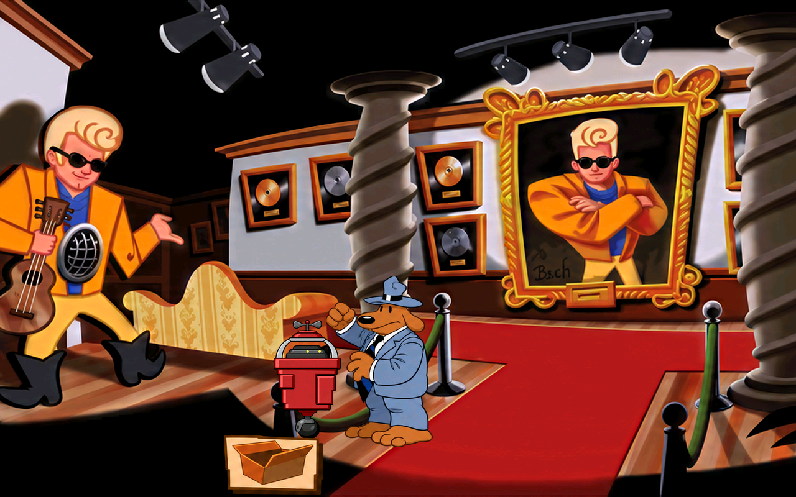

# Sam og vedlikeholdsroboten, 19. oktober 2026

Åtte nye ark fig220_01 til 08 er tegnet, egenkontrollert og native mottatt med 44 ruter. Alle 44 er registrert tegnet og visuelt sett mot original, native PNG og faktisk motorutsnitt. Fem animasjoner i rom 43 gir 255 skjermbufferkontroller fra figurstart uten avvik. Dette er egenkontroll og en arbeidsmodd, ikke ny godkjenning fra Tom eller separat Claude-kontroll.

## Motiv og kilder

Dette er Sam sammen med den røde vedlikeholdsroboten i Bumpusvilles gang, rom 43, kostyme 220, format 0x61. Originalarkene, Sam-hovedarket og originalfigurene i produksjonsmotorens rombilder er sett før nytegning. Main-repoets docs/GJENNOMGANG.md beskriver roboten som åpnes med boken og har blå plugg helt til venstre. Nabokostyme 219s generiske coin machine-beskrivelse brukes ikke til å tegne et nytt brusautomatdesign.

Sam beholder brun pels, blågrå dress og hatt, hvit skjorte og mørk blå/svartstripet slips. Den røde roboten har grå bue, mørkt kontrollfelt, to små lyse punkter, rød kropp, et lite hjul under og et grått kontrollpanel med blå kobling og oransjerød ledning. Åpne, lukkede og lave tilstander følger originalen. Tre faser har hatt over bart hode med synlig mellomrom. Fig220_08 er bare roboten. Små paneler og flygende grå deler skal ikke erstattes av hele Sam eller fjernes som bakgrunnsstøy.

Prosjektbibliotekets [fast figurstørrelse](https://github.com/Tombonator3000/prosjektbibliotek/blob/main/losninger/grafikk/figurark-fast-storrelse.md) og [SCUMM v6-lag og skygger](https://github.com/Tombonator3000/prosjektbibliotek/blob/main/losninger/grafikk/scumm-v6-kostymer-skygge-og-soppelruter.md) er brukt sammen med prosjektets eksisterende mottak. Bibliotekets PASS gjelder kildeprosjektenes tester; egne kontroller står nedenfor. Beskyttede jobbfiler er uendret. Premiss- og oppsettavklaringen ligger separat i premissretting.txt og i de faktiske promptene.

## Leveranser og faktiske bildebestillinger

| Jobb | Ruter | Tegningsgrunnlag |
| --- | ---: | --- |
| [fig220_01](../../jobber/fig220_01/resultat.png) | 8 | [A, seks Sam-poser](unik-A-prompt01.txt) og [D, robot/deler](unik-D-prompt01.txt) |
| [fig220_02](../../jobber/fig220_02/resultat.png) | 5 | [B, åpning og kontrollpanel](unik-B-prompt01.txt) |
| [fig220_03](../../jobber/fig220_03/resultat.png) | 5 | B, eksakt samme originale RGBA i et annet lag |
| [fig220_04](../../jobber/fig220_04/resultat.png) | 5 | B, eksakt samme originale RGBA i et annet lag |
| [fig220_05](../../jobber/fig220_05/resultat.png) | 5 | [C, reaksjon og svevende hatt](unik-C-prompt01.txt) |
| [fig220_06](../../jobber/fig220_06/resultat.png) | 5 | C, eksakt samme originale RGBA i et annet lag |
| [fig220_07](../../jobber/fig220_07/resultat.png) | 10 | C og D |
| [fig220_08](../../jobber/fig220_08/resultat.png) | 1 | D, roboten alene |

Fire vellykkede kall med innebygd image_gen, ett forsøk per tegningsgrunnlag. Eksakt modellnavn vises ikke. Faktiske prompter og alle råbilder er bevart. Ingen CLI/API-fallback. Delte kall skal ikke summeres som nye kall for hver jobb. Ruteplanen grupperer bare eksakt lik kilde-RGBA med samme bredde/høyde: 21 ulike originalutsnitt til 44 spillruter. Alle runtime-ID-er og lag beholdes. Identiske kilder gir også byteidentiske native PNG-er.

Toms tidligere tillatelse til Python-rensing og plassering er brukt. Tegningens egen alfa renses for verktøyets løse fargeglød og plasseres etter rektangulære mål. Ingen hard originalmaske klipper de nye konturene. Tre sammensatte originalruter har små deler langt fra hovedmotivet: hovedtegningen og grådelene plasseres separat slik at Sam ikke strekkes ut for å fylle tomrommet. De tre grå 4x4-delene er eksakt like etter dokumentert vertikal vending; den genererte grådelen følger vendingen. Åtte små grå enkeltprikker har også kildebevis og er bevart. Den rødbrune bevegelsesstreken er tegnet som en jevn kurve.

## Kontroll og begrensninger

- Egenkontroll med uendrede grenser: 44 av 44 OK, ingen SJEKK eller FEIL i siste ark. Native mottak: 44 OK, null til gjennomsyn, null manglende. Kvittering i myke220-kvittering.json. Ingen motor- eller pipelineendring.
- Alle 44 sett som original/native/motor i fire motor-og-kilde220-final-bilder. Hele rombilder for Sam/robot, den åpne roboten, svevende hatt og roboten alene er også sett. Smådeler er forstørret bare i kontrollbildene. Romdump f+4 viser tegningen logget ved f.
- Produksjonsmotoren fra den faktiske Linux-pakken 19. oktober: SHA-256 c7b4e73c882ea999a55bb11b01f2fe3cabb17dcedc87859fae2255a876d821be. Pakkens spillfiler, isolert HOME/XDG og kopierte saves, dummy lyd/skjerm, normal grafikkmodus og null musikk. Ingen lokal retningskrok.
- Fem tvungne animasjoner 1, 7, 8, 9 og 10, 240 bilder hver. Alle 44 nye ruter registrert tegnet. 300 skjermbufferkontroller totalt, 255 fra figurstart uten avvik. Fem avvik på 160 ved frame 36 før testfigur er identiske med de fem uendrede baselineprøvene mot d31c30f2. Tidligere rombytte-/bakgrunnsfeil er ikke erklært løst.
- Førbildene er bevart i for-delvending. Vendingen av en liten grådel ble korrigert før siste kontroll; alle fem motorprøver er kjørt på nytt etter rettingen. Motorlogger.zip har fem baseline-, fem før- og fem sluttlogger med hashmanifest. Et feil filmønster i rapporthjelperen ble rettet slik at alle de faktiske loggene tas med. Dette endrer ingen spillgrafikk eller motor.
- Alle 32 beskyttede kildefiler og alle 19 782 tidligere PNG-er er uendret. Kandidaten legger til 44 native filer, totalt 1590 native og 19 826 PNG-er. Alle tidligere filer er bevart. Før publiseringsverktøyet skriver sjekksummer, er bare mod.json endret: antall native og kostyme220 i listen. Alle tre tidligere stasher er bevart.

Ingen naturlig gjennomspilling, interaktiv Windows-test, ny nettleserprøve, ny Tom-godkjenning eller separat Claude-kontroll. Gamle omrissmerknader, motiv-/bakgrunns-/kantrester, z-målinger og uobservert costume204_286 står fortsatt åpne.

## Publisering og videre arbeid

Kildene leveres på gpt-arbeid. Native publiseres additivt fra d31c30f2 etter kontroll av gjeldende fjern-SHA. Faktisk publisering, tilbakehenting og kontroll av alle PNG-er står i mottak-publisert.json når den finnes. Før den kvitteringen foreligger, er importert/publisert fortsatt false i fremdriften.

159 av 1758 figurjobber har resultat, 1599 mangler pluss returer og spill-/stilkontroll. Neste bunke er fig110_01 til 07 etter GRAFIKKLISTE.md. Fire VR-ark fig246_16 til 19 står fortsatt separat åpne etter dokumentert verktøyavslag; samme avviste grunnlag bestilles ikke på nytt. Automatisk grafikkfortsettelse beholdes. Gamle nattprosesser er ikke startet.

Felles Linux-/Windows-release fra 19. oktober har fortsatt 1546 native ruter. Denne nye bunken på 44 er foreløpig en oppdatering av kilde- og modgrenen; ikke kall nedlastingspakkene oppdatert til 1590. Pakkene oppdateres ved neste samlepunkt og kontrolleres fra faktiske nedlastinger.

