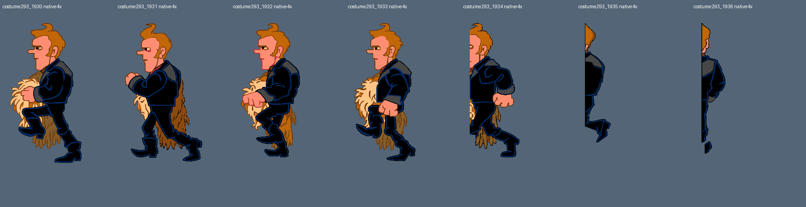

# Lee-Harveys gangsekvens og avkapping ved fryseren

2026-10-22 10:41 (Codex)

Ett helt figurark,fig293_02,er laget med innebygd image_gen,egenkontrollert,native mottatt,motorobservert og visuelt sett. Det inneholder13 nye native ruter1930..1942 fra kostyme293:syv egne nye tegninger og seks hele RGBA-aliaser. Publisert additivt som hd-mod c157c3373d6ac0e1c609c55ad09a9b8a7d329167, grafikkilde fb82eaf89da47ed329237ce4508ba8c6af0e0b93. Alle21905 filhash er hentet tilbake og bekreftet.505 av1758 figurark har resultat,1253 er uten pluss returer og sluttkontroll.293-familien har20/55 kontrollerte native ruter,34 produserbare mål gjenstår inkludert to returer,og1927 holdes uten omprøving.

Elleve faktiske bildekall ga11 råbilder,ingen nye verktøyavslag og fire forkastede kvalitetskandidater. De to gjenopptatte returene1921/1922 har fortsatt feil hode-/øyefeste og er ikke levert. Første1935-utkast hadde et oppdiktet øye i avkappet bakhode og er erstattet av N1935R. Første1936-utkast var for smalt og er erstattet av N1936R. Ingen avviste utkast brukes som stil-/identitetsanker. Forrige1927-avslag holdes uten nytt kall.

Komplette originaler og godkjente Sam-/Max-mastere er sett før hvert motiv. Alle13 originalflater er bekreftet med0 RGB565-avvik i faktisk kjøkkenrom56,palett0. Originalen styrer Lee-Harveys identitet,okerhår,rosa hud,svart jakke med mørkeblå kanter,grå mansjetter og den løse Bigfoot-forkledningen. Maskefjesets brune linjer er tegninger,ikke åpne hull. Avkappingen ved venstre kant og den lille separate skodelen er kildebekreftet og bevart. Aliaser er bekreftet med lik størrelse og alle hele RGBA-verdier.

Ekte egen alfa,fast4x og to originalpikslers marg. CORE128,IoU0,6,dekning0,8 og tillatt hel affin forskjell0,88..1,12 er beholdt. Bare hele tegninger er plassert,med høyst3HD-pikslers flytting. Alle kildefestede øyemarkeringer og den separate skodelen er innen3HD-piksler. Ingen lokal Python-flytting av trekk,originalfragmenter eller hard originalmaskeklipping. Faktisk egenkontroll og myke-figurer-mottak gir13 OK,0 til gjennomsyn og0 originalfragmenter.

Endelige rene baseline-/kandidatprøver avslutter med exit0 og118/120 nullkontroller hver. De to eksisterende bufferavvikene i frame24/25 ved rominngang,før testaktøren i frame40,har identiske koordinater og begge RGB-verdier. Etter testaktørstart80/80 null per side. Alle13 originale aktørflater og8HD-naboområder er like,med0 uforklarte HD-endringer. Tretten før/etter-varianter,fire hele motorbilder og alle23 faser er faktisk visuelt sett. Konstruert aktør29,animasjon1/raw6,med faktisk nedlastet Linux-binær5abfeae205d9e2c415e503c76a332bd92d638b81937c6403ce40c69d2c98e676. Ingen naturlig full gjennomspilling,ny interaktiv Windows-/webtest eller ny Tom-/Claude-godkjenning.

Første baseline og kandidat ble rendret,men rapporthjelperen feilet før kvittering fordi en lokal kopi av kostymeheaderen manglet. Begge første prøver er bevart og regnes ikke bestått. Hashbekreftet header er gjenbrukt,og begge endelige v2-prøver har normale exitkvitteringer. Ingen motor-/pipelinekode er endret. Tidligere uavklart shell143 fra forrige rapport er fortsatt bevart,som historikk.

Alle21892 tidligere moddfiler og21886 PNG bevares unntatt oppdatert mod.json/manifest.1432 beskyttede jobbfiler og tre stasher står urørt. Felles Linux-/Windows-release sam-max-hd-2026-10-22-lee-harvey har fortsatt3641 native og mangler20 fra293-familien. Den kalles ikke oppdatert med3661. Videre arbeid:fig293_03 med frysersekvensens faktiske kildekontekst,deretter gjenværende returer. Gamle nattprosesser startes ikke. Grafikkautomatikken fortsetter,all grafikk er ikke ferdig.

Bibliotekskilder:figurark-fast-storrelse,scumm-v6-kostymer-skygge-og-soppelruter og publisert-mod-er-fasit. Samme SCUMM v6-pin c9091321060acfc8f037767c18f8279a86305b7e. Bevis:fremdrift.json,rutekart-fig293_02.json,indre-feste-kontroll.json,smaadel-kontroll.json,automatisk-mottak.json,motor-sammenligning.json,motor-bufferkontroll.json og mottak-publisert.json.

## Felles pakke bekreftet 2026-10-22 11:09

Alle 13 native ruter fra denne bunken er med i begge faktisk nedlastede og kontrollerte pakker med 3661 native ruter. https://github.com/Tombonator3000/Sam-Max-HD/releases/tag/sam-max-hd-2026-10-22-kjokken. Se rapporter/felles-release-20261022-kjokken/publisert.json og moddfiler-kontroll.json. Historikken ovenfor gjelder produksjonskontrollen før dette pakkesamlepunktet.
