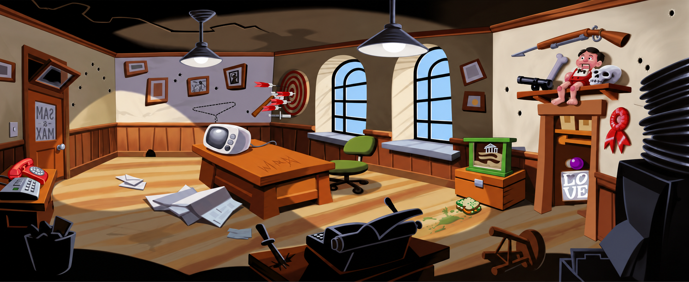
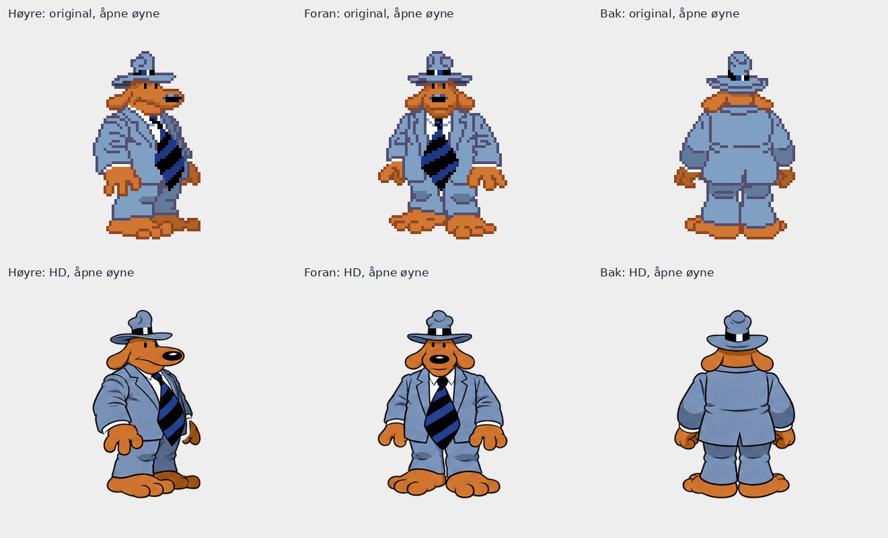
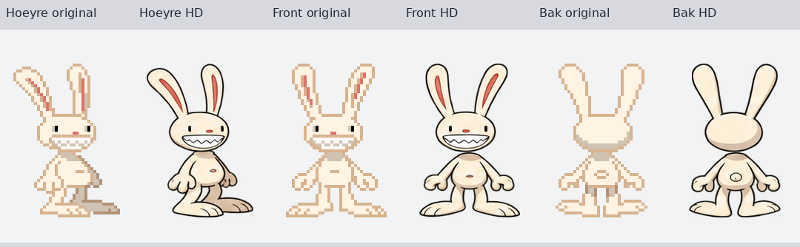

# Godkjent stilpilot og videre HD-konvertering

2026-10-13 17:32, norsk tid.

Tom har godkjent hovedarkene, kontoret og figurpiloten og bedt om å fortsette resten av HD-konverteringen. [Godkjenningen](TOMS-GODKJENNING.json) gjelder den videre produksjonsretningen. De fire nye pilotjobbene er ferdigstilt med innebygd ChatGPT-bildegenerator og autorisert presis bildebehandling. Eksakt generatormodell er ikke eksponert.

| Leveranse | Kontroll | Omfang |
| --- | --- | --- |
| rom007_del1av2 | OK | Kontoret, venstre del |
| rom007_del2av2 | OK | Kontoret, høyre del |
| fig002_01 | OK | Sam, 9 ruter |
| fig003_01 | OK | Max, 28 ruter |

Alle 37 rutebokser stemmer nøyaktig med originalen. De fire små øyelokkrutene er kontrollert separat fordi standardkontrollen hopper over dem. Åpne og lukkede øyne er lagt over hodene på originalens fester. Kropp/hode/hender, åtte gangfaser og talehoder er sammenlignet samlet. Korrigerte øyelokk følger lokal hud og dekker pupillene fullt. Ingen originalmaske brukes til å tvinge figurkonturer.

Kontoret er én sammenhengende fullscene på 1952 x 800. De to leveransene har 1120 x 800 byte-identisk overlapp og eksakte gråbånd. Første romforsøk er avvist kontrollbevis. Dørskiltets bakvendte bokstaver og LO/VE-skiltets oppsett er bevart.

Se [Sam-blink](sam-blink-overlay.png), [Max-blink](max-blink-kontroll.png), [gangfaser](max-gange-kontaktark.png) og [talehoder](max-tale-sammensatt.png). [Gangdiagnosen](max-gange-diagnose.gif) bruker valgt visningstid og dokumenterer ikke originaltiming eller motoravspilling.

[Kildegrunnlag](GRUNNLAG.md), [sluttkontroll](sluttkontroll.json), [leveranseregister](fremdrift.json), [Sam-rutekart](rutekart-sam.json) og [Max-rutekart](rutekart-max.json) bevarer grunnlag og målinger. Alle 18 låste kilde-/hovedarkfiler er uendret. Jobbnotatene oppgir råforsøk, metoder, korrigeringer og SHA-256.

Motorimport, originaltiming, spilltest og ny HD-mod er ikke utført. Disse er separate uverifiserte trinn. Neste produksjonsarbeid følger bestilling 2 og deretter resten av GRAFIKKLISTE.md med Toms eksisterende autorisasjon.
