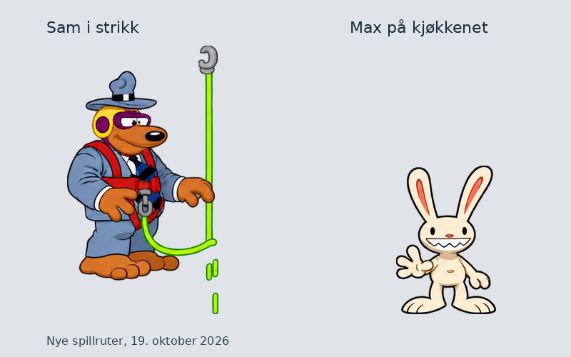

# Sam i strikk og Max på kjøkkenet, 19. oktober 2026

Sju nye figurark og 78 native HD-ruter: fig314_01 til 04 har 32 Sam-ruter, fig294_01 til 02 har 20 Max-ruter, og fig315_01 har 26 små hatte-/håndfragmenter. Alle er tegnet med innebygd image_gen. Ni faktiske bildekall, ingen CLI/API-fallback. Verktøyet oppgir ikke eksakt modellnavn. [Kildegrunnlag](kildegrunnlag.md) dokumenterer motiv, spillkontekst og godkjente stilankere.

## Bilder og faktiske prompter

| Jobb | Ruter | Produksjon |
| --- | ---: | --- |
| [fig314_01](../../jobber/fig314_01/resultat.png) | 10 | [prompt01](fig314_01-prompt01.txt) |
| [fig314_02](../../jobber/fig314_02/resultat.png) | 6 | [prompt01](fig314_02-prompt01.txt) |
| [fig314_03](../../jobber/fig314_03/resultat.png) | 10 | [prompt01](fig314_03-prompt01.txt) |
| [fig314_04](../../jobber/fig314_04/resultat.png) | 6 | [prompt01](fig314_04-prompt01.txt) |
| [fig294_01](../../jobber/fig294_01/resultat.png) | 4 | [prompt01](fig294_01-prompt01.txt) |
| [fig294_02](../../jobber/fig294_02/resultat.png) | 16 | [prompt01](fig294_02-prompt01.txt) |
| [fig315_01](../../jobber/fig315_01/resultat.png) | 26 | [prompt01](fig315_01-prompt01.txt), [prompt02](fig315_01-prompt02.txt), [prompt03](fig315_01-prompt03.txt) |

Første smådelsark feilet på manglende små deler og feil størrelse/avstand på løse deler. De seks minste fragmentene ble tegnet på nytt; to ble rettet en gang til for riktig åpent hakk og de små separate delene. Siste plassering har en HD-piksel luft ved den lille løse tappen i rute 1923. De avviste versjonene og kontrollutfallene er bevart. Utkastet 3151935-vurdert-retting-ikke-brukt.txt ble aldri sendt til bildeverktøyet: forstørret kontroll viste at hånddelen allerede var med.

Toms tidligere uttrykkelige ja til Python-rensing/plassering er brukt. klargjor.py.txt og klargjor315.py.txt bevarer tegningens egen alfa og omriss og plasserer delene etter originalens rektangulære mål. Originalens harde pikselmaske klipper ikke nye tegninger. Løse strikk-/hånddeler er beholdt; fig315 bruker egne bokser for løse deler i samme rute. rutekart-*.json og fremdrift.json knytter sluttbildene til SHA-256.

Sluttkontrollen stoppet også på 17 rent magentafargede piksler ved alfa 1 etter RGBA-skaleringen av lilla utstyr. rens-magenta.py.txt erstatter bare disse RGB-verdiene med nærmeste tegningskjerne. All alfa og alle andre piksler er uendret. magenta1-rens.json har hver koordinat og før-/etter-SHA. Det lilla utstyret beholdes. Nytt mottak og nye motorprøver ble kjørt etter rensen.

## Kontroller og grenser

- Sju ark består egenkontroll med uendrede grenser: 77 av 77 målte ruter OK. Costume315_1922 har bare 18 originalpiksler og hoppes over av standardkontrollen. Den er kontrollert særskilt som original/native/motor, med begge løse deler og native IoU 0,747. minste-seks-ekstrakontroll.json dokumenterer alle seks små ruter.
- Separat native mottak med uendrede grenser: 78 OK, null til gjennomsyn, null manglende. myke314-kvittering.json, myke294-kvittering.json og myke315-kvittering.json er sluttkvitteringene. Tidligere kvitteringer med tillegg i filnavnet er historiske.
- Alle 78 er visuelt sammenlignet som original, faktisk native PNG og faktisk motorutsnitt i de åtte motor-og-kilde*-final-*.png-bildene. Små fragmenter er forstørret bare i kontrollbildene. Romdump f+4 viser ruten logget ved tegning f. Tre hele motorbilder er også lagret.
- Fem siste motorprøver med den uendrede produksjonsmotoren i Linux-pakken fra 18. oktober: Sam314 animasjon 1 og 7, Max294 animasjon 1 og 7, Sam315 animasjon 1. Alle 78 registrert tegnet. 250 skjermbufferkontroller, 205 fra figurstart uten avvik. Max-kjøkkenprøvene har null i alle 100 målinger. De tre rom 61-prøvene har hver det kjente avviket160 ved frame 36 før testfiguren settes inn ved frame 40; øvrige målinger null. Det er samme kjente oppstartsfeil som tidligere, ikke en motorretting.
- Lokal metadatafeil ved kostymelisten og feil feltnavn for antall er rettet til eksisterende strengliste/costume_cels, med bevarte førdata og ny sluttprøve. Første Max-assert ventet rom 61-avviket også på kjøkkenet; prøven ga faktisk null og er kjørt på nytt med strengere nullkrav. Ingen motor- eller pipelinekode er endret. Rålogger og tidligere oppsettprøver ligger uendret i motorlogger.zip.
- Tvunget avspilling med produksjonsbinær uten lokal retningskrok, isolert HOME/XDG, kopierte saves, dummy lyd/skjerm og null musikk. Ikke naturlig gjennomspilling, interaktiv Windows-test eller ny nettleserprøve. Separat Claude-kontroll og Toms nye stilgodkjenning gjenstår. Tidligere bakgrunns-/kantrester, omrissmerknader og uobservert costume204_286 står fortsatt åpne.
- Alle 28 beskyttede jobbfiler er uendret. Alle 19 622 tidligere PNG-er er byteidentiske. Kandidaten legger til 78, med 1464 native og 19 700 PNG-er totalt. Alle eldre filer er bevart; bare mod.json er oppdatert før publiseringsverktøyet skriver nye sjekksummer. Se bevaringskontroll.json og tillegg.json.

## Publisering og neste arbeid

Kildeark, prompter og kontrollbevis går til gpt-arbeid. Native filer legges additivt til hd-mod fra f7a3f275. Publisering og faktisk tilbakehenting kvitteres etterpå i mottak-publisert.json og fremdrift.json. En lokal kandidat regnes ikke som publisert. Ingen grafikk går til main.

Direkte telling etter de sju arkene: 135 av 1758 figurjobber har resultat; 1623 mangler, pluss kjente returer og stil-/spillkontroll. Neste Sam-/Max-jobb er fig246_01. Nedlastingspakkene fra 18. oktober inneholder fortsatt 1386 native ruter; denne runden bygger ikke nye Linux-/Windows-pakker.

[Max på kjøkkenet fra motorprøven](max-kjokken-motor.png)
