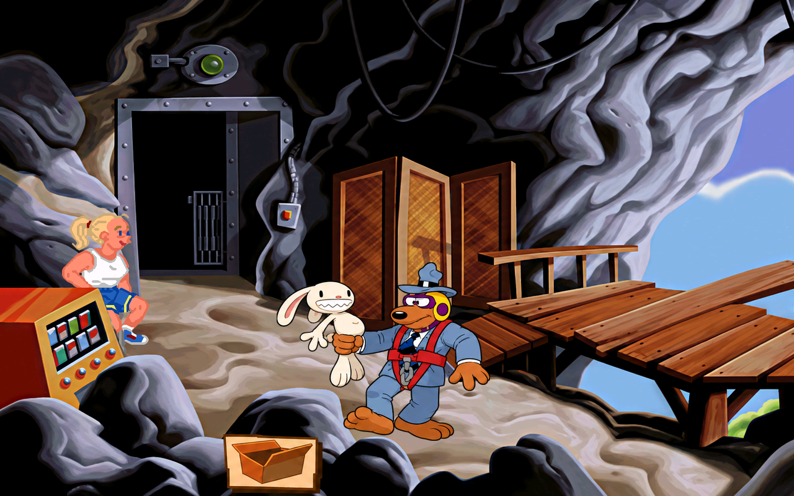

# Strikkhopp: ti nye figurark, 18. oktober 2026

96 nye native HD-ruter fra fig307_01 til 05 og fig312_01 til 05. Sam i sele har 52 ruter for ståing, gange og tale. Sam som griper og løfter Max og hopper har 44. Ti resultatark på 1536 x 1024 med ekte alfa ligger i jobber/<jobb>/resultat.png. Laget med innebygd image_gen; 15 bildekall, ingen CLI/API-fallback. Eksakt modellnavn er ikke oppgitt av verktøyet.

Se [kildegrunnlag.md](kildegrunnlag.md) for originaltolkning, spillkontekst, hovedark og prosjektbibliotekets tre brukte løsningskort. Alle originale ruteark og Sam-/Max-masterne er sett. Rødt seletøy og gult/lilla hodeutstyr er bekreftet i originalspillet. Max legges bare til i rutene der originalen har ham. Bakfraposer får ikke ansikter; siste fallrute er et originalt fragment, ikke en hel figur.

## Leveranser og faktiske prompter

| Jobb | Ruter | Produksjon og retting |
| --- | ---: | --- |
| [fig307_01](../../jobber/fig307_01/resultat.png) | 5 | [prompt01](fig307_01-prompt01.txt), [prompt02](fig307_01-prompt02.txt); bare høyrehodet fra rettingen |
| [fig307_02](../../jobber/fig307_02/resultat.png) | 8 | [prompt01](fig307_02-prompt01.txt) |
| [fig307_03](../../jobber/fig307_03/resultat.png) | 23 | [prompt01](fig307_03-prompt01.txt), [prompt02](fig307_03-prompt02.txt), [prompt03](fig307_03-prompt03.txt) |
| [fig307_04](../../jobber/fig307_04/resultat.png) | 8 | [prompt01](fig307_04-prompt01.txt) |
| [fig307_05](../../jobber/fig307_05/resultat.png) | 8 | [prompt01](fig307_05-prompt01.txt) |
| [fig312_01](../../jobber/fig312_01/resultat.png) | 10 | [prompt01](fig312_01-prompt01.txt), [prompt02](fig312_01-prompt02.txt) |
| [fig312_02](../../jobber/fig312_02/resultat.png) | 11 | [prompt01](fig312_02-prompt01.txt), [prompt02](fig312_02-prompt02.txt); andre hele bilde avvist, bare øyelokkelement brukt |
| [fig312_03](../../jobber/fig312_03/resultat.png) | 9 | [prompt01](fig312_03-prompt01.txt) |
| [fig312_04](../../jobber/fig312_04/resultat.png) | 8 | [prompt01](fig312_04-prompt01.txt) |
| [fig312_05](../../jobber/fig312_05/resultat.png) | 6 | [prompt01](fig312_05-prompt01.txt) |

Tidlige haketapper og lilla perler er avvist. Sam beholdes uendret under Max sin avgrensede øyelokkrens. Førbilder, avviste råforsøk og metadata er bevart, så de ikke blir forvekslet med siste resultat. Kun bilder som rutekartene peker på er valgt.

Python-rensing/plassering er tidligere uttrykkelig godkjent av Tom. [klargjor.py.txt](klargjor.py.txt) plasserer tegningens eget omriss og myke alfa innen kildens mål, uten å klippe langs et pikselomriss. Hudtonejusteringen etter haketegning gjelder bare oransje hud-RGB; resten og alfa beholdes. [rens-max-oyne.py.txt](rens-max-oyne.py.txt) gjenskaper øyerensen pikselidentisk: 630 endrede RGB-piksler i fire avgrensede områder, uendret alfa, uendret Sam og resten av bildet. Det korrekte AI-tegnede øyelokkelementet er beholdt med originalens kildebekreftede farge.

## Kontroll og praktiske grenser

- Egenkontroll: 96 av 96 OK. Separat native mottak med uendrede grenser: 96 OK, null til sjekk. Kvitteringer: myke307-kvittering.json og myke312-kvittering.json.
- Alle 96 er visuelt sammenlignet som original, faktisk native PNG og faktisk motorutsnitt i motor-og-kilde307-final-01 til 05 og motor-og-kilde312-final-01 til 04. Romdump f+4 viser rutene logget ved tegning f. De tidligere kilde-og-leveranse307-bildene er fra før siste hakeretting og er historiske.
- Sluttgrunnlaget er ti motorprøver: fem siste 307-prøver for ståing/tale, tre tidligere gangeprøver med de 24 byteidentiske gangerutene og to 312-prøver med hele animasjon1 og7. Alle 96 rutene er registrert tegnet;340 skjermbufferkontroller fra figurstart uten avvik. Se motor-final-oppsummering.json, per-runde-metadata og uendrede rålogger i motorlogger.zip.
- Første motorassert stoppet på 160 skjermbufferpiksler ved frame 36. Feilen er bevart i motor307-forste-stopp.zip. Kontroll med uendret publisert grunnlag 5212c395 har nøyaktig samme avvik før testfigur settes inn ved frame 40. Den reviderte prøven krever akkurat dette kjente oppstartsavviket og null i alle målinger etter figurstart. Ingen annen feil er tillatt. Dette er ikke en motorretting eller en nullpåstand for hele oppstarten.
- Lokal ScummVM c9091321 med PR32 og en separat lokal retningskrok for QA. Ingen motor-/pipelinekode endret eller sendt med grafikken. Tvunget avspilling, ikke naturlig gjennomspilling eller interaktiv Windows-/nettest. Z-kantmålingene er ikke null. Separat Claude-kontroll og ny stilgodkjenning fra Tom gjenstår.
- 40 beskyttede kildefiler har samme SHA. Alle 19 526 tidligere PNG-er er byteidentiske i kandidaten. 96 nye PNG-er legges til, 1386 native og 19 622 PNG-er totalt. [bevaringskontroll.json](bevaringskontroll.json) og tillegg.json er fasit for kontrollen.

## Publisering

Kildeark og kontrollbevis publiseres på gpt-arbeid. Native modden publiseres deretter additivt fra 5212c395 til hd-mod. Faktisk tilbakehenting og SHA-kontroll skal kvitteres i mottak-publisert.json og fremdrift.json; en kandidat eller lokal motorprøve alene er ikke publisering. Ingen gammel grafikk skal bygges om fra et ufullstendig arbeidsbord.

Direkte telling etter disse ti: 128 av 1758 figurjobber har resultat. 1630 mangler resultat, i tillegg til kjente returer og særskilt stil-/spillkontroll. Neste Sam-jobber er fig314_01 til 04, så fig294_01 til 02. Andre motiv-/bakgrunnsrester og manglende observert costume204_286 er fortsatt åpne.

Publisert og hentet tilbake 2026-10-18T13:39:52.774950+02:00: kildecommit e63675d6ce38cc820ffffa4aa0a35abe9deea829, hd-mod f7a3f275d62de5327d5a0d08153dfbc17ffdb9c9. Alle 19 622 kandidat-PNG-er er identiske med publisert modd, alle 96 nye native SHA-er er bekreftet, 1386 native totalt. SHA256SUMS er godkjent ved hent. Se mottak-publisert.json.
