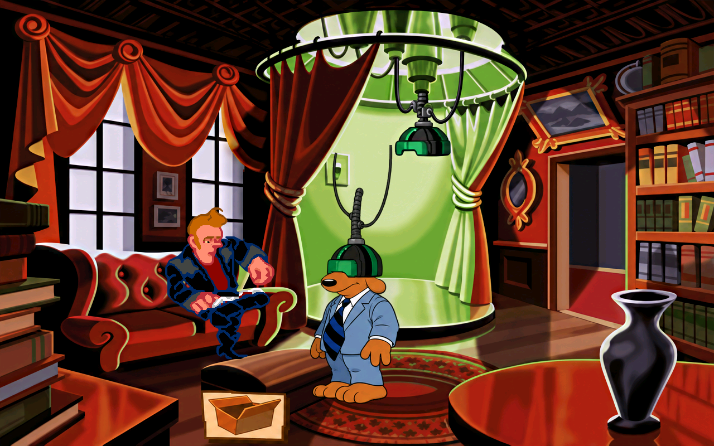

# VR-kabler: ti ark og 62 ruter, 19. oktober 2026

Fig246_01 til 10 er nytegnet og kontrollert. Alle 62 ruter er med. De viser Sam i rom 48, Bumpusvilles VR-rom, først under den hengende hjelmen og deretter med hjelmen på. Max er ikke på disse ti arkene, selv om kostymeserien heter Sam og Max. Den beskyttede generelle prompten er bevart; riktig motiv er beskrevet separat i premissretting.txt og produksjonspromptene.

Innebygd image_gen, fire faktiske bildekall, ingen CLI/API-fallback. Eksakt modellnavn vises ikke. Tre kall tegner 19 ulike originalposer, og ett retter armen i costume246_1924. De 62 originalrutene har bare 19 forskjellige RGBA-utsnitt med samme størrelse. Identiske kildepiksler får samme nytegning, med alle produksjonsrutene bevart. Ulike poser er ikke slått sammen. ruteplan-unik.json, original-duplikater.json og sluttkontrollen dokumenterer hver kobling.

## Leveranser og faktiske prompter

| Jobb | Ruter | Felles tegningsgrunnlag |
| --- | ---: | --- |
| [fig246_01](../../jobber/fig246_01/resultat.png) | 6 | [A](unik-A-prompt01.txt) og [armretting](costume246_1924-prompt01.txt) |
| [fig246_02](../../jobber/fig246_02/resultat.png) | 6 | [B](unik-B-prompt01.txt) |
| [fig246_03](../../jobber/fig246_03/resultat.png) | 7 | [C](unik-C-prompt01.txt) |
| [fig246_04](../../jobber/fig246_04/resultat.png) | 7 | C |
| [fig246_05](../../jobber/fig246_05/resultat.png) | 7 | C |
| [fig246_06](../../jobber/fig246_06/resultat.png) | 7 | C |
| [fig246_07](../../jobber/fig246_07/resultat.png) | 7 | C |
| [fig246_08](../../jobber/fig246_08/resultat.png) | 5 | C |
| [fig246_09](../../jobber/fig246_09/resultat.png) | 5 | C |
| [fig246_10](../../jobber/fig246_10/resultat.png) | 5 | C |

Originalene, Sam-/Max-hovedarkene og eksisterende fig247_01 er sett før nytegning. docs/figurer.csv og docs/GJENNOMGANG.md bekrefter rom, kostyme og VR-utstyr. Svart hjelm, grønt visir, grå ribbet kobling og to tynne kabler beholdes. Fedoraen er synlig før hjelmen tas på og er ikke lagt til der den skjules. Fem små hodedreininger, blant annet den nesten skjulte nesetippen, er kontrollert mot forstørret original. Ingen øyne er lagt på glasset.

Prosjektbibliotekets figurark-fast-storrelse og scumm-v6-kostymer-skygge-og-soppelruter er lest. PASS gjelder testene i opphavet. Metoden brukes med prosjektets eksisterende v6-mottak og produksjonsmotor, uten kodeendring. Det svake første søket er fulgt opp med --match any. Spillets eget godkjente design brukes.

Toms tillatelse til Python-rensing/plassering er brukt. klargjor-kildesett.py.txt pakker originale piksler som tre midlertidige tegningsgrunnlag. plasser-unike.py.txt renser tegningenes egen alfa, beholder delene og plasserer prototypene i alle 62 målposisjoner ved 4x. Ingen hard originalmaske klipper nytegnet omriss. Råbilder, prototyper, førbilder og råvalg er bevart. Eventuell ren RGB-avrunding ved alfa 1 er dokumentert i prototype-kvitteringer.json, med uendret alfa.

## Kontroller og grenser

- Egenkontroll med uendrede grenser: 61 av 62 ruter OK, én SJEKK. Costume246_1925 har samme mål og plass, men omriss-IoU avrundet 0,75. Den er sett særskilt som original/native/motor og beholdt med merknaden. Native mottak har IoU 0,764 og dekning 0,857. Første 1924 løftet armen for høyt og fikk SJEKK 0,71; armen er nytegnet til riktig lave posisjon og siste kontroll er OK.
- Separat native mottak med uendrede grenser: 62 OK, null til gjennomsyn, null manglende. Se myke246-kvittering.json. Tekniske mål er ikke stilgodkjenning.
- Alle 62 er registrert tegnet og visuelt sett mot original og native PNG i seks motor-og-kilde246-final-bilder. Romdump f+4 viser ruten logget ved tegning f. Tre hele motorstillbilder er lagret.
- Tvunget animasjon 1 i rom 48, 360 bilder: 90 skjermbufferkontroller, 81 fra figurstart uten avvik. Publisert grunnlag db0b45d7 har samme kjente avvik 160 ved frame 36 før testfiguren; kandidaten har samme avvik og øvrige målinger null. Ikke en motorretting eller naturlig gjennomspilling.
- Produksjonsmotoren i Linux-pakken fra 18. oktober er brukt uten lokal retningskrok, med isolert HOME/XDG, kopierte saves, dummy lyd/skjerm og null musikk. Binær-SHA i motor-oppsummering.json, rålogger for grunnlag og kandidat i motorlogger.zip. Ingen ny interaktiv Windows- eller nettleserprøve. Toms nye stilgodkjenning og separat Claude-kontroll gjenstår. Tidligere bakgrunns-/kantrester og uobservert costume204_286 står åpne.
- Alle 40 beskyttede jobbfiler er uendret. Alle 19 700 tidligere PNG-er er byteidentiske. Kandidaten legger til 62 native filer, med 1526 native og 19 762 PNG-er totalt. Alle gamle filer bevart; bare mod.json er oppdatert før publiseringsverktøyet skriver sjekksummer. Se bevaringskontroll.json og grunnlag-filer-db0b45d7.json.

## Publisering og videre arbeid

Grafikk og bevis går til gpt-arbeid. Native legges additivt til hd-mod fra db0b45d7. Faktisk publisering og tilbakehenting kvitteres etterpå i mottak-publisert.json og fremdrift.json. Ingen ny grafikk går til main.

145 av 1758 figurjobber har resultat, 1613 mangler pluss returer og stil-/spillkontroll. Neste jobb er fig246_11. Dette avslutter ikke Toms bestilling om all grafikken. Den nye automasjonen Fullfør Sam & Max-grafikken er ACTIVE hvert 20. minutt i samme chat og gjenopptar arbeidet. Gammel nattkontroll fra 15. oktober forblir PAUSED. Maskinen og skrivebordsappen må kjøre for lokale filer. Pakkene fra 18. oktober har fortsatt 1386 native til nye pakker faktisk er bygget og kontrollert.

