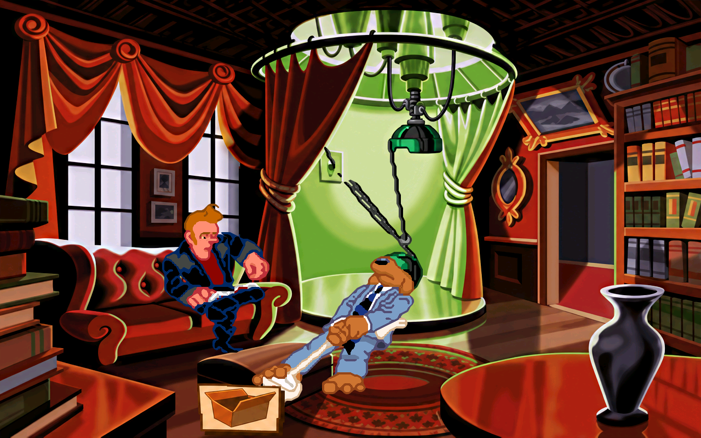

# VR-kabler, seks leverte ark og fire åpne, 19. oktober 2026

Fig246_11 til 15 og fig246_20 er levert med 20 ruter. Sam går med VR-hjelmen, og deretter tegnes Sam og Max sammen i den uvanlige diagonale posituren fra originalen. Sam har svart hjelm med grønne felter, grå ribbet kobling og to tynne kabler. Sam-/Max-hovedarkene, alle ti originalreferanser og de forstørrede ansiktene er sett. Sam vender nesten rett fram i de to første F-posene og i siste H-pose; en sideprofil fra stilreferansen skal ikke overstyre originalen. Max har to små svarte øyne og rosa nese, uten synlig tannglis i disse posene.

Spillets egne bilder, docs/figurer.csv og docs/GJENNOMGANG.md er motivgrunnlaget. [Spatvarks gjennomgang](https://gamefaqs.gamespot.com/pc/562679-sam-and-max-hit-the-road/faqs/52036) bekrefter VR-hjelmen i Bumpusville, men avklarer ikke denne posituren. Den brukes derfor ikke som belegg for håndgrep eller kroppsform. Prosjektbibliotekets figurark-fast-storrelse og scumm-v6-kostymer-skygge-og-soppelruter er brukt med prosjektets eksisterende v6-mottak. PASS gjelder opphavets tester; egne motorprøver er dokumentert her.

## Hva som er levert

| Jobb | Ruter | Valgt tegningsgrunnlag |
| --- | ---: | --- |
| [fig246_11](../../jobber/fig246_11/resultat.png) | 3 | Tre uendrede prototyper fra forrige bunke, eksakt like kildepiksler |
| [fig246_12](../../jobber/fig246_12/resultat.png) | 6 | [D](unik-D-prompt01.txt) og [E](unik-E-prompt01.txt) |
| [fig246_13](../../jobber/fig246_13/resultat.png) | 4 | E |
| [fig246_14](../../jobber/fig246_14/resultat.png) | 3 | [F, forsøk 4](unik-F-prompt04.txt) |
| [fig246_15](../../jobber/fig246_15/resultat.png) | 3 | F, forsøk 4 |
| [fig246_20](../../jobber/fig246_20/resultat.png) | 1 | [H, forsøk 2](unik-H-prompt02.txt) |

Innebygd image_gen, åtte vellykkede bildekall og ett avvist kall. Eksakt modellnavn vises ikke. Ingen CLI/API-fallback. Alle faktiske prompter og råbilder er bevart, også [F1](unik-F-prompt01.txt), [F2](unik-F-prompt02.txt), [F3](unik-F-prompt03.txt), [H1](unik-H-prompt01.txt) og den avviste [G-bestillingen](unik-G-prompt01.txt). Delte bildekall skal ikke summeres som nye kall for hver jobb.

De 32 planlagte originalrutene har 21 ulike RGBA-utsnitt. Tre er eksakt like allerede kontrollerte originaler fra forrige, publiserte bunke og får deres byteidentiske prototyper. De seks leverte arkene har 17 ulike tegningsgrunnlag: tre gjenbrukte og 14 nye. Ingen ulike originalposer er slått sammen. Alle koblinger og de tre gjenbrukte prototypene er kontrollert i sluttkontroll.py.txt. Tegnet rute2012 er bevart som utkast, men er ikke levert fordi resten av fig246_19 mangler.

Toms tidligere tillatelse til Python-rensing og plassering er brukt. Tegningens egen alfa renses og settes inn med originalens rektangulære mål. Ingen hard originalmaske klipper det nye omrisset. Halogjennomsiktighet og løse fargeprikker utenfor den tegnede figuren fjernes fra den genererte alfaen; originalfargene brukes ikke til å male en ny figur. Sam, Max og kablene er sett etter rensing i faktisk motorutsnitt. plasser-unike.py.txt, råvalg, førbilder og prototype-kvitteringer dokumenterer det.

## Kontroller

- Egenkontroll med uendrede grenser: 14 OK, seks SJEKK om omriss: 1988, 1995 til 1998 og 2000. Bredde/høyde 100 prosent og flytting 0 i arkene. Tidlig 1999 fikk FEIL 0,58. Ansiktsvinkel og plassering er nytegnet; siste 1999 er OK. Førbildene er bevart. Ikke kall de seks SJEKK-rutene automatisk godkjent.
- Separat native mottak med uendrede grenser: alle 20 OK, null til gjennomsyn, null manglende. Kvittering i myke246-kvittering.json. Native IoU for 1995 til 1998 er 0,757, 1999 er 0,836 og 2000 er 0,742. Tekniske mål er ikke stilgodkjenning.
- Alle 20 er registrert tegnet og visuelt sett som original/native/motor i to motor-og-kilde246-final-bilder. Romdump f+4 viser ruten logget ved tegning f. Tre tvungne animasjoner 1, 7 og 8 i rom 48, uten lokal retningskrok. 220 skjermbufferkontroller, 193 fra figurstart uten avvik.
- Tre kjente avvik 160 ved frame 36 før figurstart er de samme som i publisert grunnlag. Baseline for 7/8 er denne rundens uendrede 44dbaf3b; baseline for 1 er forrige kandidats motor-runde.json, med alle PNG-er dokumentert identiske med publisert 44dbaf3b. Ikke en ny motorretting.
- Produksjonsmotoren fra Linux-pakken 18. oktober, binær-SHA 241b6f05e2fd7b3db030065b4825b1dc3d44fe75fa1b3c37c338668b4e0e5fa0, med isolert HOME/XDG, kopierte saves, dummy lyd/skjerm og null musikk. Rålogger i motorlogger.zip. En hjelpeprøve mistet venv ved at symlenken til Python ble løst til system-Python; de to faktiske feilloggene er bevart. Riktig venv-kall er kjørt etterpå. Ingen installasjon eller motor-/pipelineendring.
- Alle 40 beskyttede kildefiler og alle 19 762 tidligere PNG-er er uendret. Kandidaten legger til 20 native filer, med 1546 native og 19 782 PNG-er totalt. Alle gamle filer er bevart, bare mod.json er oppdatert før publiseringsverktøyet skriver sjekksummer. Se bevaringskontroll.json og grunnlag-filer-44dbaf3b.json.

Ingen naturlig gjennomspilling, interaktiv Windows-test, ny nettleserprøve, ny Tom-godkjenning eller separat Claude-kontroll. Tidligere bakgrunns-/kantrester, z-målinger, omrissmerknader og uobservert costume204_286 er fortsatt åpne.

## Det som står åpent og neste arbeid

Fig246_16 til 19 har 12 ruter og ingen resultatfil. Tre unike kildeposer dekker 11 av disse; bildeverktøyet avviste G på output-stadiet med moderation_blocked, kategorier violence/self-harm. Den tolvte ruten, 2012, finnes bare som utkast fordi resten av arket mangler. Avslaget og request-ID ligger i unik-G-feil01.json. Samme avviste grunnlag er ikke bestilt på nytt, og ingen omgåelse er brukt. Arbeid med andre originale poser er uavhengig. Disse fire arkene skal ikke regnes ferdige eller forsøkes omgått ved senere automatikk.

151 av 1758 figurjobber har resultat, 1607 mangler pluss returer og spill-/stilkontroll. Neste uavhengige bunke er fig220_01 til 08. Automatisk fortsettelse Fullfør Sam & Max-grafikken er ACTIVE hvert 20. minutt; gammel nattkontroll er PAUSED. Linux-/Windows-bygg 39284089372 og 39284093710 er startet, men må være ferdige og faktiske nedlastinger må kontrolleres før de regnes levert. Byggene henter hd-mod under byggingen; faktisk SHA og innhold skal kontrolleres, ikke antas fra starttidspunktet.

Kildene går til gpt-arbeid, native legges additivt til hd-mod fra 44dbaf3b etter kontroll av at remote ikke er endret. Faktisk publisering og tilbakehenting kvitteres i mottak-publisert.json. Ingen grafikk går til main.

